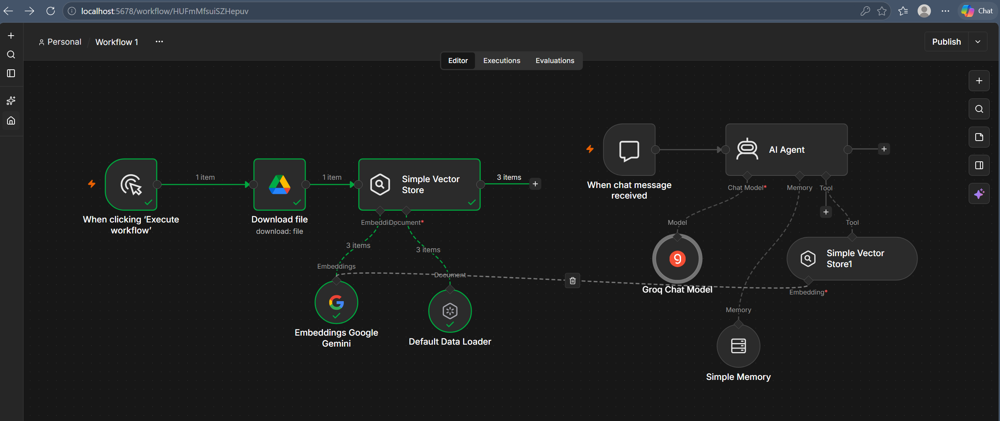
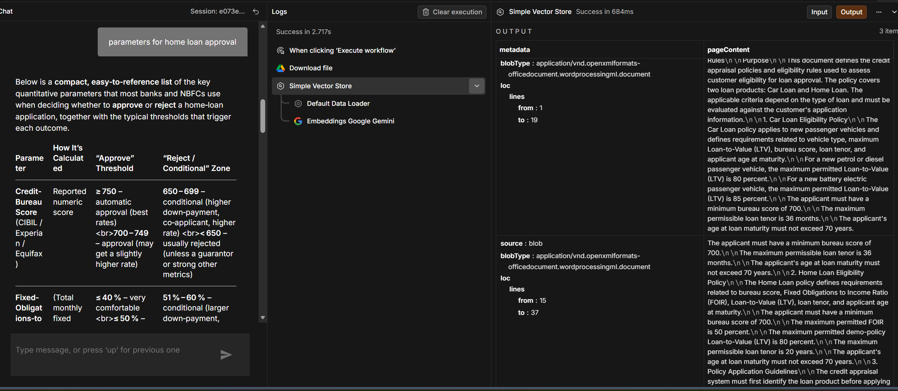
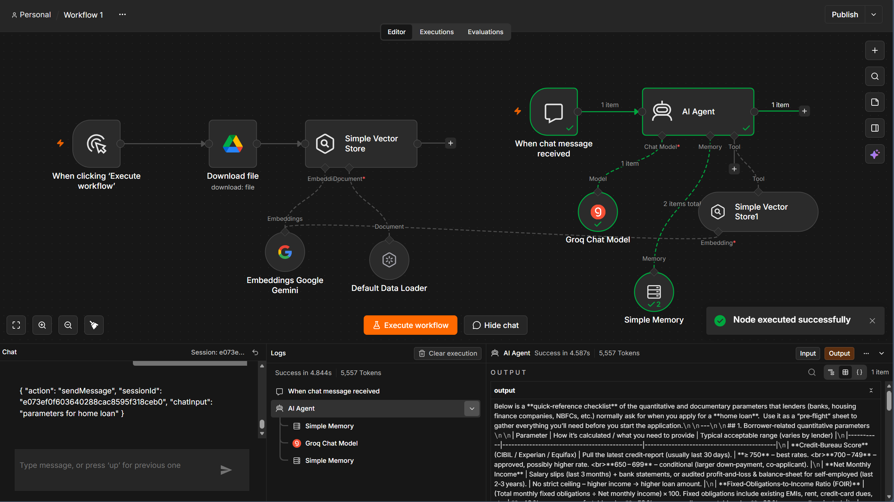
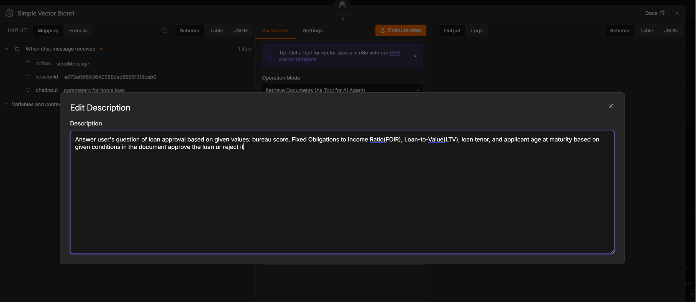

# 🏠 Home Loan Approval AI Agent using n8n and RAG

## 📌 Project Overview

The **Home Loan Approval AI Agent** is an AI-powered document question-answering and preliminary loan eligibility assessment prototype built using **n8n, Retrieval-Augmented Generation (RAG), Google Gemini embeddings, and the Groq Chat Model**.

The system retrieves relevant information from a loan policy document and uses an AI agent to answer user queries about home loan eligibility criteria, financial parameters, and approval conditions.

The objective is to make loan policy information easier to access and understand through a conversational interface.

## 🎯 Project Objectives

- Automate the retrieval of relevant information from loan policy documents.
- Answer questions about home loan eligibility requirements.
- Explain financial parameters such as credit score, Fixed Obligations to Income Ratio (FOIR), Loan-to-Value (LTV), loan tenure, and applicant age.
- Demonstrate how RAG can ground AI responses in document content.
- Build a conversational AI workflow with memory using n8n.

## 🏗️ Workflow Architecture

The project consists of two main workflow components.

### 1. Document Ingestion and Vector Storage

1. **Manual Trigger:** Starts the document processing workflow.
2. **Google Drive – Download File:** Retrieves the loan policy document.
3. **Default Data Loader:** Loads the document content for processing.
4. **Google Gemini Embeddings:** Converts document content into vector embeddings.
5. **Simple Vector Store:** Stores the document representations for semantic retrieval.

### 2. Conversational AI Agent

1. **When Chat Message Received:** Accepts a user's question.
2. **Groq Chat Model:** Generates AI responses.
3. **Simple Memory:** Maintains conversational context.
4. **Simple Vector Store Tool:** Retrieves relevant loan policy information.
5. **AI Agent:** Uses the retrieved information and language model to generate a response.

## 🔄 How It Works

1. The loan policy document is downloaded from Google Drive.
2. The document is processed and converted into embeddings.
3. The embeddings are stored in a vector store.
4. The user submits a question through the n8n chat interface.
5. The AI agent retrieves relevant information from the vector store.
6. The Groq-powered model uses the retrieved context to formulate an answer.
7. The response is displayed to the user, with memory supporting follow-up questions.

This approach demonstrates **Retrieval-Augmented Generation (RAG)**, where an AI model uses retrieved document information to answer domain-specific questions.

## 🛠️ Technologies Used

| Technology | Purpose |
|---|---|
| n8n | Workflow automation and orchestration |
| Groq Chat Model | Language generation and response synthesis |
| Google Gemini Embeddings | Document embedding generation |
| Google Drive | Loan policy document storage and retrieval |
| Simple Vector Store | Semantic document retrieval |
| Default Data Loader | Document ingestion and processing |
| Simple Memory | Conversational context management |
| RAG | Grounding responses in retrieved document content |

## 💡 Example Use Case

**Sample query:**

"What parameters should be considered for home loan approval?"

The agent can retrieve and summarize relevant policy information, including:

- Credit bureau score requirements
- Fixed Obligations to Income Ratio (FOIR)
- Loan-to-Value (LTV) limits
- Loan tenure restrictions
- Applicant age at loan maturity
- Other applicable eligibility conditions

The exact criteria depend on the loan policy document used by the workflow.

## 📸 Project Screenshots

### Workflow Overview

### Loan Policy Retrieval

### AI Agent Execution

### Vector Store Tool Configuration

## 🚀 Key Learnings

- Designing multi-node workflows in n8n.
- Implementing a basic RAG pipeline for document-based question answering.
- Connecting an LLM to a vector store as a retrieval tool.
- Generating embeddings for semantic search.
- Managing conversational context with memory.
- Integrating document retrieval and generative AI into a practical business use case.

## ⚠️ Limitations and Responsible Use

- This project is a prototype for document-based question answering and preliminary eligibility assessment.
- It does not constitute an official lending decision or guarantee loan approval.
- Results depend on the accuracy, completeness, and currency of the source policy document.
- Actual lending decisions require verified applicant information, current lender policies, and appropriate human review.
- The screenshots document the workflow; an importable n8n workflow export is not included unless added separately.

## 🔮 Future Enhancements

- Add support for multiple loan policy documents.
- Improve document chunking and retrieval quality.
- Provide source references for generated answers.
- Add structured applicant input and transparent eligibility checks.
- Introduce validation, error handling, and evaluation of response accuracy.
- Export the n8n workflow JSON to enable reproducibility.

## 👩‍💻 Author

**Mehak Chhabra**

---

*Built as a practical exploration of workflow automation, retrieval-augmented generation, and conversational AI for financial document analysis.*